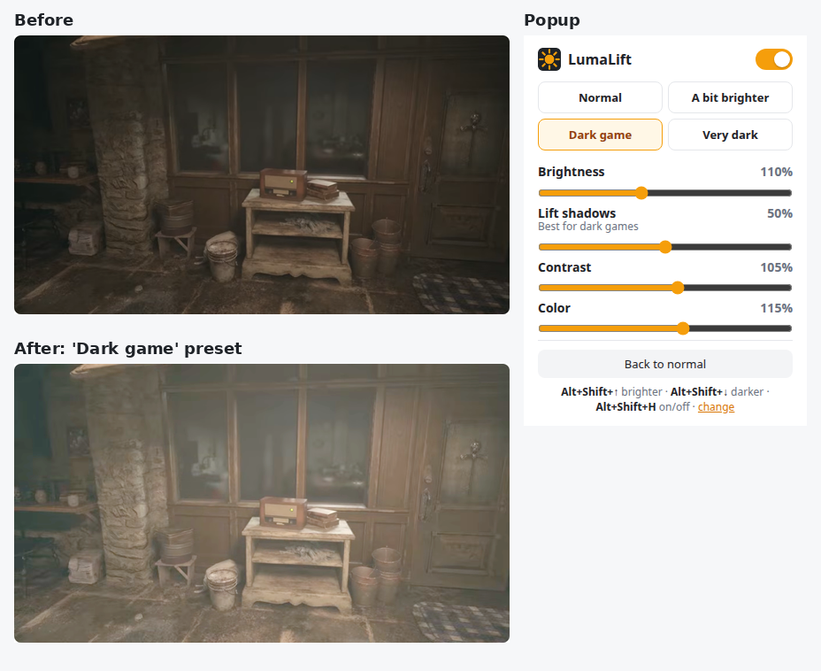

# LumaLift

**Make dark YouTube videos easy to see.** LumaLift is a small Chrome extension that lifts the shadows and brightness of YouTube videos, which helps a lot with dark gaming videos on a dim laptop screen.



## Features

- **Lift shadows**: a gamma correction that makes dark areas much brighter while white stays white. This works better for dark scenes than plain brightness, which washes out the bright parts.
- **Sliders** for brightness, lift shadows, contrast and color.
- **Presets**: Normal, A bit brighter, Dark game and Very dark.
- **Keyboard shortcuts** with a short on-screen message, also in fullscreen:
  - `Alt+Shift+↑` brighter (+10%)
  - `Alt+Shift+↓` darker (−10%)
  - `Alt+Shift+H` on/off

  You can change them at `chrome://extensions/shortcuts`.
- Your settings apply to every YouTube tab and are remembered.
- Available in English and Dutch, following your Chrome language.

## Install

LumaLift is not in the Chrome Web Store. Load it as an unpacked extension:

1. Download `lumalift-1.0.0.zip` from the [latest release](https://github.com/brvale97/lumalift/releases/latest) and unzip it, or clone this repository.
2. Open `chrome://extensions` and turn on **Developer mode** (top right).
3. Click **Load unpacked** and choose the unzipped folder (or the `extension` folder of the repository).
4. Pin LumaLift with the puzzle icon in the toolbar.

Keep the folder where it is: Chrome loads the extension from it. To update, replace the files and click the reload icon on the LumaLift card in `chrome://extensions`.

It also works in other Chromium browsers such as Edge and Brave.

## How it works

The content script adds a CSS `filter` to every `<video>` element on youtube.com: `brightness()`, `contrast()` and `saturate()`, plus an SVG `feComponentTransfer` gamma filter for lifting shadows. The page itself, thumbnails and text are left alone. Filters run on the GPU, so playback stays smooth.

## Privacy

LumaLift only runs on `youtube.com`. It collects nothing and sends nothing anywhere; your settings are stored locally with `chrome.storage.local`.

Permissions:

- `storage`: remember your settings.
- `scripting`: start working in YouTube tabs that were already open when you install it.
- Access to `youtube.com`: apply the filter to videos there.

## Development

```sh
npm install
npm test              # local test page in headless Chromium
npm run test:youtube  # also a real, dark YouTube gaming video
npm run zip           # build lumalift.zip from extension/
```

The tests load the extension in headless Chromium with Playwright and check the presets, sliders, shortcuts, on-screen message, re-injection and the Dutch translation. Screenshots are written to `test/output/`.

Translations live in `extension/_locales/<language>/messages.json`.

## License

[MIT](LICENSE)

The screenshot shows gameplay from Resident Evil Village (Capcom), taken from a YouTube video for illustration.
